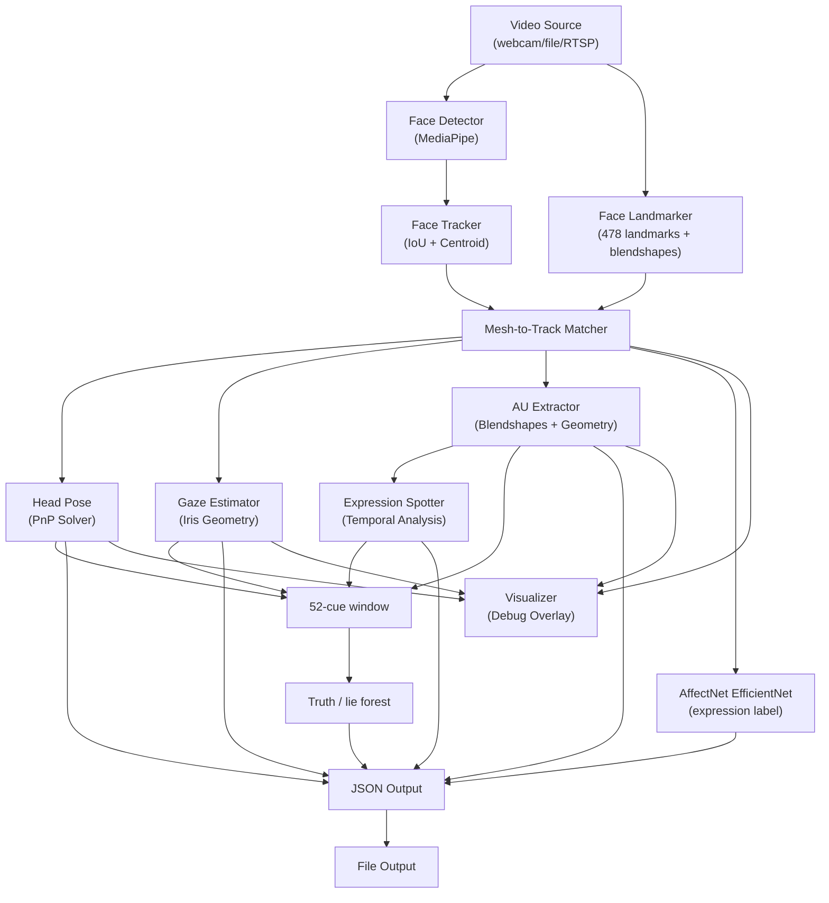

# Facial Cue Extraction System — Walkthrough

## Status: Webcam build shows an expression and a truth/lie score

Run from `AU` with `.\run.bat`. Truth, lie, or uncertain is on the left. The expression is on the top right. Press Q to stop.

## Project Structure

```
facial_cues/
├── __init__.py
├── main.py                           # CLI entry point
├── README.md                         # Full documentation
├── requirements.txt                  # 5 core dependencies
├── models/
│   ├── face_landmarker.task          # Face landmark + blendshapes
│   ├── enet_b0_8_best_vgaf.pt        # Live expression network (AffectNet, 8 classes)
│   └── deception_mlp.pth             # Truth/lie forest (52 facial cues)
├── ml_models/
│   ├── affectnet_emotion.py          # Expression label from a face crop
│   ├── deception_cues.py             # Clip summary used by the forest
│   └── deception_classifier.py
├── training/
│   ├── extract_trial_clips.py
│   └── train_trial_deception.py
├── run.bat                           # webcam | video FILE | train
├── config/
│   ├── default.yaml                  # All configurable parameters
│   └── schema.py                     # Typed config loader (dataclasses)
├── capture/
│   └── video_source.py               # Webcam, file, RTSP unified source
├── detection/
│   └── face_detector.py              # MediaPipe Tasks face detection
├── tracking/
│   └── face_tracker.py               # IoU + centroid persistent tracker
├── landmarks/
│   └── face_mesh.py                  # MediaPipe FaceLandmarker (478 points)
├── head_pose/
│   └── pose_estimator.py             # PnP-based pitch/yaw/roll estimation
├── gaze/
│   └── gaze_estimator.py             # Iris-based gaze direction
├── au_detection/
│   └── au_extractor.py               # Blendshape + geometric AU extraction
├── temporal_spotting/
│   └── expression_spotter.py         # Micro/macro expression event detection
├── outputs/
│   └── json_writer.py                # Structured JSON serialization
├── pipeline/
│   └── orchestrator.py               # Pipeline tying all modules together
├── visualization/
│   └── visualizer.py                 # Debug overlay renderer
└── tests/
    └── test_pipeline.py              # Sanity check suite
```

## Architecture Diagram



## Key Files

| Module | File | Lines | Key Responsibility |
|--------|------|-------|-------------------|
| Config | [schema.py](file:///d:/VS_Code_Workspace/FInal%20Year%20Project/Iteration%201/facial_cues/config/schema.py) | 190 | Typed config with YAML loading + deep merge |
| Capture | [video_source.py](file:///d:/VS_Code_Workspace/FInal%20Year%20Project/Iteration%201/facial_cues/capture/video_source.py) | 125 | Unified webcam/file/RTSP capture |
| Detection | [face_detector.py](file:///d:/VS_Code_Workspace/FInal%20Year%20Project/Iteration%201/facial_cues/detection/face_detector.py) | 107 | MediaPipe Tasks face detection |
| Tracking | [face_tracker.py](file:///d:/VS_Code_Workspace/FInal%20Year%20Project/Iteration%201/facial_cues/tracking/face_tracker.py) | 173 | IoU+centroid greedy matching tracker |
| Landmarks | [face_mesh.py](file:///d:/VS_Code_Workspace/FInal%20Year%20Project/Iteration%201/facial_cues/landmarks/face_mesh.py) | 120 | 478-landmark extraction + blendshapes |
| Head Pose | [pose_estimator.py](file:///d:/VS_Code_Workspace/FInal%20Year%20Project/Iteration%201/facial_cues/head_pose/pose_estimator.py) | 105 | PnP solver → pitch/yaw/roll + smoothing |
| Gaze | [gaze_estimator.py](file:///d:/VS_Code_Workspace/FInal%20Year%20Project/Iteration%201/facial_cues/gaze/gaze_estimator.py) | 155 | Iris position → 3D gaze direction |
| AU Detection | [au_extractor.py](file:///d:/VS_Code_Workspace/FInal%20Year%20Project/Iteration%201/facial_cues/au_detection/au_extractor.py) | 350+ | Blendshape-based + geometric fallback |
| Temporal | [expression_spotter.py](file:///d:/VS_Code_Workspace/FInal%20Year%20Project/Iteration%201/facial_cues/temporal_spotting/expression_spotter.py) | 200 | Onset/offset velocity → micro/macro events |
| Output | [json_writer.py](file:///d:/VS_Code_Workspace/FInal%20Year%20Project/Iteration%201/facial_cues/outputs/json_writer.py) | 170 | Buffered JSON with schema builders |
| Pipeline | [orchestrator.py](file:///d:/VS_Code_Workspace/FInal%20Year%20Project/Iteration%201/facial_cues/pipeline/orchestrator.py) | 360 | Frame processing loop + module wiring |
| Viz | [visualizer.py](file:///d:/VS_Code_Workspace/FInal%20Year%20Project/Iteration%201/facial_cues/visualization/visualizer.py) | 230 | BBox, landmarks, pose axes, gaze, AU bars |

## How to Run

```powershell
cd "d:\VS_Code_Workspace\Final Year Project\AU"

.\run.bat
.\run.bat video "D:\path\to\clip.mp4"
.\run.bat train
```

PowerShell will not start `run.bat` without the `.\` prefix.

## Test Results

```
TEST 1: Config Loading              ✅
TEST 2: Module Initialization       ✅ (all 8 modules)
TEST 3: Synthetic Frame Processing  ✅ (blank frame → 0 faces, no crash)
TEST 5: Output Schema Validation    ✅ (JSON serializes cleanly)
```

## Design Decisions

1. **MediaPipe Tasks API** instead of deprecated `mp.solutions` — future-proof for mediapipe >= 0.10.x
2. **Blendshapes for AU detection** — MediaPipe's FaceLandmarker outputs FACS-compatible blendshapes (52 shapes), which we map to 18 AUs. Falls back to geometric proxy if blendshapes unavailable.
3. **Greedy IoU+centroid tracker** — lightweight, no deep re-ID needed for webcam scenarios (1-4 faces)
4. **PnP head pose** — deterministic, no model needed, works from 6 landmark correspondences
5. **Temporal spotting via velocity** — onset/offset detection classifies events by duration into micro (<200ms) or macro (>500ms)
6. **Expression and truth/lie are separate.** The expression network does not feed the forest. Anger is not treated as a lie, and a smile is not treated as the truth.

## What the preview shows

- **Left:** `TRUTH`, `LIE`, or `UNCERTAIN`. Uncertain means the lie probability is between 0.40 and 0.60.
- **Right:** one of anger, contempt, disgust, fear, happy, neutral, sad, surprise. A non-neutral guess below 0.35 is shown as neutral.
- **Also drawn:** box, landmarks, pose axes, gaze, and the eight strongest action units.

The forest was trained on 113 courtroom clips from Real-life Deception Detection 2016, holding out each speaker. Clip accuracy is **62.8%** and lie F1 is **0.57**. A webcam face was not in that training set, so a score near one half is the honest output. The write-up of this result is `AU/paper/ieee_deception.tex`.
